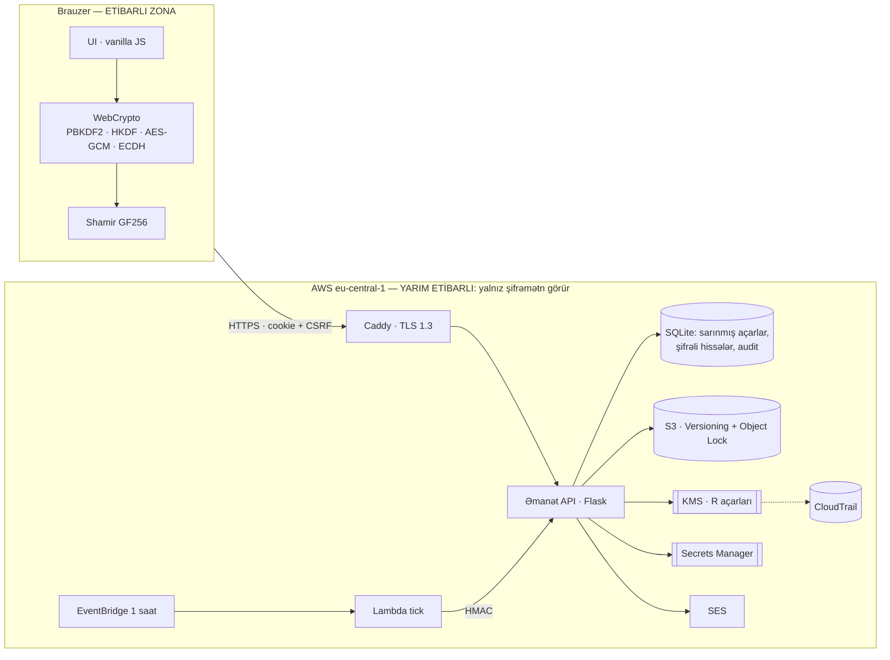
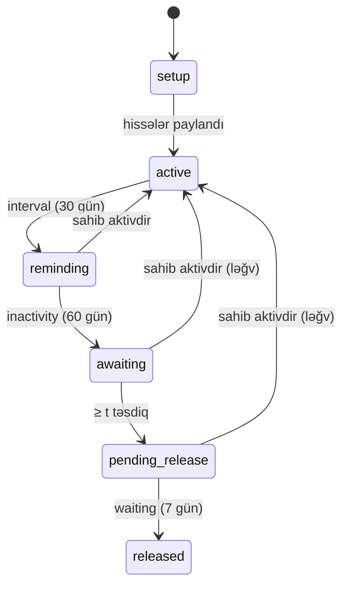
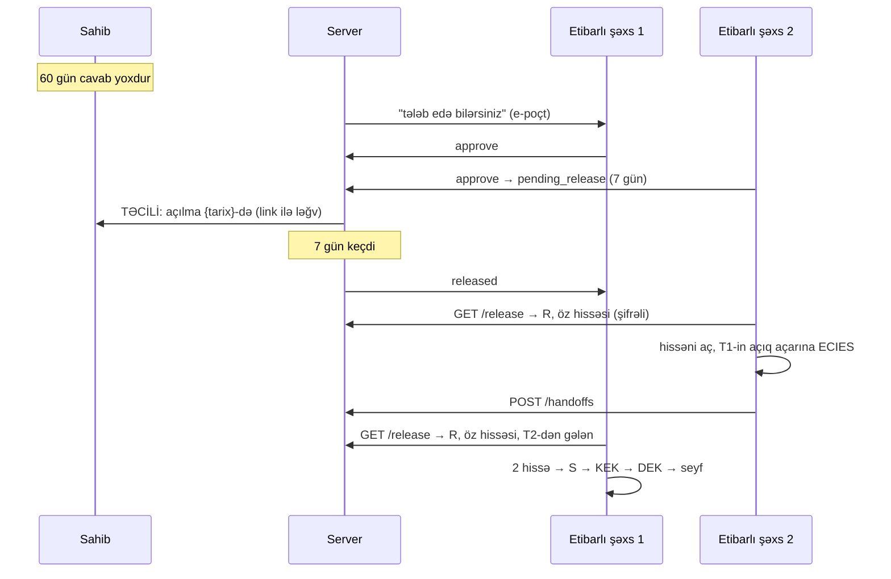

# Arxitektura

## Komponentlər və etibar sərhədləri



**Əsas fikir:** server **yarım etibarlıdır** (honest-but-curious). O, düzgün işləyir, amma onun gördüyü heç nə seyfi açmağa kifayət etmir. Brauzer kodu etibar zonasındadır. Bu zonanın bütövlüyü CSP, Trusted Types və `/api/integrity` manifesti ilə qorunur (R-05).

## Açar iyerarxiyası və "iki açarlı kilid"

```
             ┌───────────── brauzer ─────────────┐        ┌──── server ────┐
parol ─PBKDF2(600k)─▶ MK ─HKDF─┬▶ auth_key ────────────────▶ Argon2id(auth)
                               └▶ enc_key ─┬─ AES-GCM ─▶ wrap(priv P-256)
                                           └─ AES-GCM ─▶ wrap(DEK, "owner")
                   DEK ─ AES-GCM ─▶ seyf (doldurulmuş, versiya AAD-da) ──────▶ S3
                   S ─Shamir(t,n)─▶ hissə_i ─ECIES(pub_i)─▶ ───────────────────▶ DB
                   R ◀──────────────────── KMS.GenerateDataKey ◀─── KMS
     KEK = HKDF(S ‖ R, salt=vault_id) ─ AES-GCM ─▶ wrap(DEK, "release") ──────▶ DB
```

| Kimdə nə var | Seyfi aça bilərmi? |
|---|---|
| Server (DB + KMS) | **Xeyr** — S yoxdur |
| t etibarlı şəxs, vaxtından əvvəl | **Xeyr** — R yoxdur |
| t−1 etibarlı şəxs + R | **Xeyr** — Shamir: t−1 hissə 0 bit verir |
| t etibarlı şəxs + R (RELEASED) | **Bəli** |
| Sahib (parol və ya bərpa kodu) | **Bəli**, həmişə |

Bunu `demos/03_two_key_lock.py` və `tests/test_zero_knowledge.py` sübut edir.

## "Sağam" vəziyyət maşını



`emanet/switch.py` funksiyası **təmiz funksiyadır**: daxil olan seyf, vaxt və təsdiq sayıdır, çıxan yeni vəziyyət və görüləcək işlərdir. Bu sayədə invariantlar 990 kombinasiyalı şəbəkədə və 2 000 təsadüfi ssenaridə yoxlanılır (`tests/test_switch.py`).

## Açılma axını (sequence)



## Dizayn qərarları

| Qərar | Alternativ | Niyə bu |
|---|---|---|
| Hissələr brauzerdə birləşdirilir | Server birləşdirir | Server açıq hissəni görsə, zero-knowledge pozulur |
| ECDH P-256 | X25519 | Bütün brauzerlərin WebCrypto-sunda var |
| PBKDF2 (brauzer) + Argon2id (server) | Yalnız Argon2id | WebCrypto Argon2-ni dəstəkləmir. Xarici WASM isə təchizat zənciri riskidir (R-12) |
| SQLite (WAL) | RDS PostgreSQL | Tək instansiya, aşağı xərc, EBS snapshot. Miqyas lazım olduqda keçid asandır |
| EventBridge + Lambda planlaşdırıcısı | EC2-də cron | EC2 dayansa da planlaşdırma qalır, Lambda xətaları alarm verir |
| Lazy qiymətləndirmə + tick | Yalnız tick | Planlaşdırıcı dayansa da vəziyyət düzgün hesablanır |
| Vanilla JS, build yoxdur | React + npm | Audit ediləcək kod azdır, asılılıq yoxdur, CSP sadədir |
| Sessiya cookie-də, açarlar yaddaşda | JWT localStorage-də | XSS cookie-ni oxuya bilmir. Açarlar heç vaxt yaddaşdan kənara çıxmır |
